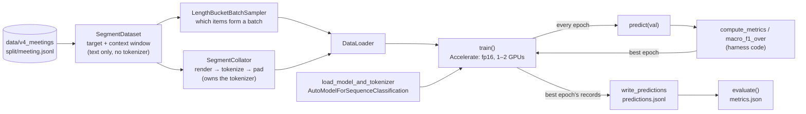

# Phase C: baselines pipeline. Engineering report

Branch `C/baselines-design` (commits `5f983e2` to `6e1d913`). Dialogue-act classification on the ICSI MRDA corpus, layer 1 (utterance classification).

---

## 0. Summary

This branch builds the shared training and evaluation pipeline for the phase-C baselines. The encoder baseline (DeBERTa-v3-base) runs end to end with it, and a two-stage (hierarchical) variant was added at the supervisor's request.

**What was built**
- A model-independent input pipeline: Dataset → length-bucketing Sampler → Collator → DataLoader.
- A model module: loading, prediction, the optimizer and LR schedule, and a training loop that runs on CPU, 1 GPU or 2 GPUs with fp16 mixed precision (through HF Accelerate).
- The harness integration: a prediction-file writer, `compute_metrics` and `evaluate()`. Training selects its best epoch with exactly the same metric code that produces `metrics.json`.
- A hierarchical classifier: stage 1 `other` vs `not_other`, stage 2 the 6 target classes, combined into one 7-class prediction.
- A trial script and Kaggle notebooks to run all of this on 2 × T4.

**First results** (validation split, one seed each, trial runs; see §5 for setup and limits)

| Model | val macro-F1 (6 target classes) |
|---|---|
| Flat 7-class classifier | 0.503 |
| Hierarchical (stage 1 + stage 2) | 0.488 |
| Stage 2 alone (6 targets, on gold non-`other` segments) | 0.758 |
| Stage 1 alone (F1 of `not_other`) | 0.614 |

**Main findings**
1. Telling the six target classes apart is comparatively easy (0.76). The hard part is **separating target segments from `other`**. With one segment of input (k = 0), many target segments ("yeah", "OK") look identical to `other` segments. Context (k > 0) is the next lever.
2. Training speed did **not** improve with fp16 and a second GPU. The step time looks dominated by fixed per-step costs rather than computation. This is an open question that needs a proper profiling study (§6).

**Status of the three families**
- The design is complete for all three families: encoder, decoder + classification head, and prompting.
- The shared pipeline is implemented and family-agnostic.
- The decoder needs only small additions: setting the pad token, the LoRA wrapper, and optional 4-bit loading.
- Prompting needs its prompt renderer and backends.

Given the time frame, the remaining work is mainly experiments, not infrastructure.

---

## 1. Scope and context

**Goal of phase C:** baselines for 7-class dialogue-act tagging (`cs` suggestion, `co` command, `aa` accept, `bk` acknowledgement/backchannel, `ar` reject, `cc` commitment, `other`) with three model families. The families share one code path, and experiments differ only in configuration. The primary metric, fixed in task B, is **macro-F1 over the 6 target classes**, excluding `other`.

**Data:** release v4, as per-meeting files (`data/v4_meetings/{train,val,test}/<meeting>.jsonl`; one line per segment: `seg_id, position, speaker, text, label`).

| Split | Meetings | Segments |
|---|---|---|
| train | 51 | 78,903 |
| val | 12 | 16,188 |
| test | 12 | 20,518 |

The label distribution is strongly imbalanced. This shapes many decisions below:

| | other | bk | aa | cs | ar | co | cc |
|---|---|---|---|---|---|---|---|
| train share | 83.4% | 6.3% | 5.5% | 2.7% | 1.0% | 0.7% | **0.4%** (298 segments) |
| val count | 13,543 | 1,029 | 817 | 451 | 149 | 111 | **88** |

Segments are short: 8.2 words on average, 95th percentile 25 words.

**Compute:** Kaggle, 2 × Tesla T4 (15 GB each, no bf16, no FlashAttention-2), a 12 h session cap, and roughly 30 GPU-h per account per week. Local development used a laptop RTX 3050 (4 GB).

---

## 2. Architecture



**Module map**

| File | Responsibility |
|---|---|
| `src/smi/inputs/dataset.py` | One item per target segment: `seg_id`, label index, left/right context texts, target text |
| `src/smi/inputs/sampler.py` | Groups item indices into batches of similar length |
| `src/smi/inputs/collator.py` | Turns a batch of items into model tensors: rendering, tokenization, padding, labels |
| `src/smi/inputs/loader.py` | `build_dataloader`: wires the three objects above together |
| `src/smi/models/model.py` | Model loading, `predict`, epoch-selection metric, `classification_report`, optimizer, scheduler, `train` |
| `src/smi/models/hierarchical.py` | The two stages' label sets and label maps, and the `combine` rule |
| `src/smi/eval/prediction_schema.py` | `write_predictions` (new), the inverse of the existing `load_predictions` |
| `src/smi/eval/evaluate.py` | `compute_metrics` (in memory) and `evaluate` (file → `metrics.json`) |
| `scripts/trial_run.py` | Temporary driver: `--mode flat\|hierarchical`, `--seeds` |
| `scripts/kaggle_flat.ipynb`, `scripts/kaggle_hierarchical.ipynb` | Kaggle notebooks running the trial script on 2 × T4 |

**Separation of concerns.** The Dataset has no tokenizer and returns plain text. That makes it shareable by the encoder, the decoder and prompting. Everything model-specific (the tokenizer, special tokens, padding) lives in the Collator, which the model family builds.

---

## 3. Design decisions, component by component

Each component lists the decision, the alternatives considered and the reason. Where a decision was checked empirically, the evidence is given.

### 3.1 Dataset (`SegmentDataset`)

| Decision | Alternatives | Reason |
|---|---|---|
| One item = `{seg_id, label, left, target_text, right}` with plain strings | seg_ids only, resolved later; one pre-joined string | Strings keep the Dataset model-independent. A pre-joined string would move the rendering (markers, separator, decoder suffix) into the Dataset, and rendering differs per family. |
| `left` and `right` ordered **closest first** | Speaking order | Truncation then always removes the last element. Renderers must reverse `left`; this rule is documented on the item type. |
| Context is clipped at meeting boundaries, never crosses meetings | — | A window spanning two meetings would be meaningless. |
| Labels as indices into the single label tuple `LABELS` | Strings | The model's class `i` and the Dataset's label `i` come from the same tuple, so they cannot disagree. |
| The test split refuses to load without `allow_test=True`, and then has `label=None` | Load test like the others | PROTOCOL §7: test gold is read only by the harness, behind an explicit flag. Predicting on test needs text, not labels. |
| Meeting files are read in **sorted** file-name order | Directory order | Directory listing order depends on the filesystem. Sorting makes index `i` the same segment on every machine, so a seeded shuffle gives the same batches everywhere. |
| `keep_labels` filter (added for the hierarchical model) | A separate dataset class | Stage 2 trains only on non-`other` targets. The filter applies to targets only: their context windows still come from every segment of the meeting. The default `None` keeps the original behaviour. |

### 3.2 Sampler (`LengthBucketBatchSampler`)

Padding every sequence to the longest in its batch wastes computation when lengths differ, so items of similar length are batched together.

| Decision | Alternatives | Reason |
|---|---|---|
| Length = **number of characters** of target + context | Token count from the model's tokenizer | Character length is model-independent, so with the same seed every model gets the same batches. Token length would tie batch composition to the tokenizer. |
| Train: shuffle → chunks of 50 batches → sort inside each chunk → cut into batches → shuffle the batch order | Global sort by length | Short MRDA segments are mostly backchannels. A global sort would make batches almost single-class, which biases gradient steps. Chunking keeps batches mixed while padding stays low. |
| Eval: sorted globally, **longest first** | Shortest first | No gradients, so no bias concern. Longest first makes an out-of-memory error appear in the first batch, not after minutes of evaluation. |
| Batches built **once**, the same order every epoch | Reshuffle every epoch | A deliberate choice: simpler, and resuming after Kaggle's 12 h cap reproduces exactly the same batches from the seed. The trade-off is the usual argument for per-epoch reshuffling (the update order is identical across epochs). Measuring its effect is a possible experiment. |
| The sampler owns its own `torch.Generator`, seeded once | The global random state | Independent of how many random numbers the model's initialisation consumes. Encoder and decoder runs with the same seed therefore see identical batches. |
| The one short batch is always **last**; `batch_size` / `drop_last` are exposed as attributes | — | Required by Accelerate's batch splitting across GPUs. Accelerate only splits full batches plus a short *final* one, and a short batch anywhere else is silently dropped. Found by reading Accelerate's sharding code (`BatchSamplerShard._iter_with_split`). |

### 3.3 Collator (`SegmentCollator`)

| Decision | Alternatives | Reason |
|---|---|---|
| Rendering: `separator.join(reversed(left) + [open + target + close] + right) + suffix` | — | One rule for all fine-tuned families. The decoder later only adds a `suffix`. |
| **No family branches** (`if encoder / if decoder`); all differences are constructor arguments (separator, markers, suffix) plus the tokenizer passed in | Branching on the family | Family knowledge stays in one place (where model and tokenizer are created), and adding the decoder does not touch code the encoder uses (PROTOCOL §5). |
| Target marked with `[T] … [/T]` as **plain text**, also at k = 0 | New special tokens; single punctuation markers; no markers at k = 0 | No new embeddings needed. At k > 0 the markers are the only way the model knows which segment carries the label. Special tokens, punctuation markers and "no markers at k = 0" are planned as experiments; the markers are a constructor argument, so these are configuration changes. |
| Separator `"\n"` for now | `tokenizer.sep_token` | **Finding:** DeBERTa-v3's tokenizer turns `"\n"` into an ordinary space (`"OK .\nyeah"` and `"OK . yeah"` give identical tokens). The model therefore sees no segment boundary. `[SEP]` survives as one token. This choice must be revisited before context experiments (k > 0). |
| One tokenizer call per batch (`padding="longest"`, `truncation=True`, `max_length`, `return_token_type_ids=False`) | Tokenize per item and pad manually; a token cache | Simpler and faster. `token_type_ids` carry no information for a single sequence; DeBERTa-v3 has `type_vocab_size = 0`. A cache was dropped as unnecessary for this data size. |
| Labels `[B]`, one per item (sequence classification); `-100` for test items | `[B, L]` with one labelled token (token classification) | The chosen head (`AutoModelForSequenceClassification`) pools one position itself and returns `[B, 7]` logits. `-100` is ignored by PyTorch's cross-entropy. |
| Truncation by the tokenizer (cuts from the end), with a **counter** of truncated inputs | Dropping whole segments farthest first | At k = 0 nothing is truncated (counter = 0 in every run). Segment-level truncation is deferred until experiments with larger k show that it matters. |
| `num_workers = 0` | Worker processes | Measured: building a batch costs 1.5 ms at k = 0 and 3.9 ms at k = 3, negligible next to a training step. Workers would also each hold a *copy* of the Collator, so the truncation counter would silently stay 0 in the main process. |

### 3.4 Model loading

| Decision | Reason |
|---|---|
| `AutoModelForSequenceClassification.from_pretrained(name, num_labels, id2label, label2id)`, with both maps built from the label tuple | Works for encoders and decoders. The class order is guaranteed to match the Dataset's. |
| Tokenizer always loaded from the same `name_or_path` as the model | They can never mismatch. A local path works too, e.g. a Kaggle dataset for runs without internet. |
| **`dtype=torch.float32` passed explicitly** | **Finding:** `transformers` 5 defaults to `dtype="auto"`, which loads in the checkpoint's stored precision. The DeBERTa-v3 checkpoints are stored in fp16: 371 MB for ~184M parameters is 2 bytes each, while BERT and RoBERTa store fp32. Reproduced with a tiny fp16 checkpoint: the default load gave `float16`, the explicit load `float32`. Training with fp16 master weights loses small updates. Mixed precision is applied later by Accelerate, on fp32 weights. |

The load report confirms the expected picture: the pretraining heads (`lm_predictions.*`, `mask_predictions.*`) are dropped, and the new 7-class head (`pooler.*`, `classifier.*`) is randomly initialised.

### 3.5 Prediction and evaluation

| Decision | Alternatives | Reason |
|---|---|---|
| `predict` returns `{seg_id: {"label", "scores"}}`, the exact shape `load_predictions` returns | Raw score arrays | The same record feeds the epoch selection (in memory) and the prediction file, with no conversion in between. |
| Softmax in fp32; label = argmax of the scores | — | The harness requires scores summing to 1 (± 1e-3), which an fp16 softmax can miss. |
| `write_predictions`: validate **every** record before writing anything; lines sorted by `seg_id`; never overwrite an existing file | Write as you go | A broken file is never created, the same predictions give a byte-identical file, and run outputs are never overwritten (PROTOCOL §4.3). |
| Two functions: `compute_metrics(records, gold)` in memory, and `evaluate(pred_path, split_dir, out_path, allow_test, extra)` | One file-based function | The training loop selects epochs in memory every epoch. `evaluate()` scores the final file. Both use the same code, so the selection metric and `metrics.json` cannot disagree. |
| `extra` fields (e.g. `selected_epoch`) are merged into `metrics.json`, but may never replace a computed field | The caller edits `metrics.json` afterwards | One writer per file. A typo can never overwrite a real metric. |
| Locked open items from task B | — | `data_version` comes from `source.json`. A record whose label is not the argmax of its scores raises (a broken pipeline). `allow_test` is always recorded. PR-AUC is `null` until its definition is decided. |

**Bit-identity.** The new selection metric (`macro_f1_over`) and `classification_report` reuse the harness's `prf_from_sets`. A first version still differed from the harness's macro-F1 by 5.5e-17: Python's built-in `sum()` (3.12+) adds floats with extended precision, while a manual loop does not. Both now use `sum()`, and the values are identical bit for bit. That makes the check "the best epoch's value in `history.jsonl` = `macro_f1_6` in `metrics.json`" usable as an exact test.

### 3.6 Optimizer and learning-rate schedule

| Decision | Reason |
|---|---|
| AdamW, lr 2e-5, weight decay 0.01; betas and eps at PyTorch defaults | The standard recipe for fine-tuning encoders. |
| Weight decay only on 2-D parameters; biases and norm weights (1-D) excluded, **split by tensor shape**, not by parameter name | Name-based rules (`"LayerNorm"`) break for decoders, whose norms are named differently. Checked: in DeBERTa every 1-D parameter is a bias or LayerNorm weight. |
| Fused AdamW when all parameters are on the GPU | Same arithmetic, one fused kernel instead of many. |
| Linear warmup (10%) then linear decay to 0, via `transformers.get_scheduler` | The built-in schedule replaces chaining two schedulers. The name is a parameter (e.g. `"cosine"`). |
| Steps counted in **optimizer steps**: `epochs × ceil(batches / grad_accum_steps)` | With gradient accumulation the optimizer steps less often than batches arrive. Verified: the planned and executed step counts match (e.g. 12,330), and the LR ends at 0. |

### 3.7 Training loop (`train`)

| Decision | Alternatives | Reason |
|---|---|---|
| Own loop on HF Accelerate | HF `Trainer`, PyTorch Lightning, plain PyTorch | The design needs a custom batch sampler, `seg_ids` inside batches, harness-based selection and its own history format. `Trainer` would need several overrides that fight its assumptions. Accelerate handles the error-prone parts (multi-GPU, fp16 loss scaling) and leaves the loop readable. |
| **Plain cross-entropy** first; class weighting is a separate, later task | Weighted CE from the start | So the effect of minority-class handling can be measured against a clean baseline. Weighted-CE details were worked out (weights ∝ (1/n_c)^α; at α = 1 every class gets 1/7 of the loss mass, against 83% for `other` with plain CE), but not used yet. |
| Gradient accumulation divides each batch's loss by **its own accumulation group's size** | Divide by `grad_accum_steps` | `.backward()` *adds* gradients. Dividing by the group size makes each step use the mean gradient, including the last, incomplete group of an epoch. |
| Gradient clipping at norm 1.0, after fp16 unscaling | No clipping | Standard for transformer fine-tuning. The logged pre-clip norm is mostly 1–10, so clipping is active on most steps. |
| Best epoch = highest val macro-F1 over the selection classes; a tie keeps the earlier epoch | Last epoch; val loss | Selection on the primary metric, computed with the harness's code. Val loss was dropped from the history. |
| The best epoch's **val predictions** are kept in memory; no checkpoints in the trial | Saving the best weights | Enough for validation results. Test predictions will need saved weights, which come with the real `run.py`. |
| History lines handed to a callback **as they are created** (printed live and appended to `history.jsonl`) | Write at the end | Progress is visible during the ~1 h runs, and a stopped run keeps its history. |
| The loss is summed **on the GPU**, read only when logging | `loss.item()` every batch | `.item()` forces the CPU to wait for the GPU (a synchronisation point) on every batch. |
| Generalised labels: `labels`, `select_labels`, `label_map` arguments | A separate loop per model | The same loop trains the 7-class flat model and both hierarchical stages. |

### 3.8 Mixed precision and two GPUs

| Decision | Reason |
|---|---|
| fp16 autocast with dynamic loss scaling (T4 has no bf16); steps skipped on overflow are counted per epoch | T4 Tensor Cores are much faster in fp16. Loss scaling prevents gradient underflow. 0 steps were skipped in all runs. |
| Data parallelism over 2 × T4 with `split_batches=True`: each batch of 32 is split 16 + 16 | Each optimizer step sees the same 32 examples as on one GPU, so the LR schedule and results stay comparable. Without splitting, the effective batch would double to 64. |
| Validation on the main process only; the other process waits at a barrier | Gathering string seg_ids across processes is avoided; validation is cheap. |
| Collective operations (`reduce` for logged losses) run on every process; files are written by the main process only | Required for correctness under multi-process execution. |

### 3.9 Hierarchical model

Requested by the supervisor as an additional configuration (not a baseline).

| Decision | Alternatives | Reason |
|---|---|---|
| Stage 1: `other` vs `not_other` on every segment; stage 2: the 6 targets, trained only on gold non-`other` segments | — | The structure asked for. Both stages are ordinary classifiers in the same loop, with a label map from the 7-class index (stage 2 maps `other` to -100, ignored by the loss). |
| Stage 1 selects its epoch by **F1 of `not_other`** | Recall of `not_other` | Recall alone is maximised by calling everything `not_other`. F1 balances finding targets against letting `other` through. |
| Stage 2 selects on the val segments whose gold label is a target class, but **predicts every val segment** | Predict only those | At inference the gold label is unknown, so stage 2 must produce scores for all segments. |
| Combination: p(other) = p₁(other); p(c) = p₁(not_other) · p₂(c) for each target c; label = argmax | Hard cascade: if p₁(not_other) > 0.5 take stage 2's argmax | It gives a proper 7-class distribution that sums to 1, and label = argmax as the harness requires. The hard cascade was evaluated afterwards on the same predictions (§5.3); the difference is small. |
| Evaluated three ways per seed: `metrics_stage1.json`, `metrics_stage2.json`, `metrics.json` (combined) | Combined only | The stage files show *where* the pipeline loses. Their numbers are bit-identical to the harness's on the 7-class case. |

### 3.10 Decoder and prompting

The design is complete for both families. The shared pipeline was built so the remaining code is small for the decoder and contained for prompting.

**Decoder + classification head.** Decided:
- `AutoModelForSequenceClassification` on a decoder (Qwen family). The classifier reads the **last real token**, because causal attention means only that token has seen the whole input.
- A fixed suffix (`"\nLabel of [T]:"`), so the pooled token is the same in every example.
- Right padding, with a pad id that never occurs in real input.
- LoRA, with the classification head fully trainable. Full fine-tuning does not fit on a T4.
- Optional 4-bit loading (QLoRA). fp16 compute with fp32 head and LoRA weights.

Already supported by the existing code: the Collator's `suffix` argument, the tokenizer's padding settings, label maps, AdamW grouping by shape, and frozen-parameter handling in `build_optimizer`. **Remaining:** setting the pad token on tokenizer and model, the LoRA wrapper, optional 4-bit loading, and a test that the pooled position is the last real token.

**Prompting.** Decided:
- local models scored by the log-probabilities of single-letter answers (A–G), giving real scores;
- hosted or frontier models by parsing the generated answer, with `scores = null` and a fallback to `other`;
- versioned prompt templates and label definitions;
- few-shot examples from train only, with a fixed seed;
- response caching;
- an experiment grid over definitions × shots × context.

It reuses the Dataset (§3.1) and the harness unchanged. **Remaining:** the prompt renderer and the backends.

Given the time frame, the remaining work for all three families is mainly **experiments**, not infrastructure.

---

## 4. Verification

| What | How | Result |
|---|---|---|
| Dataset windows | Real val data, k = 2 | Context in correct order, empty at meeting starts, 16,188 items |
| Test guard | Load test without and with `allow_test` | Refused / 20,518 items with `label=None` |
| Sampler | Train and val, k = 0 and 3 | Every index exactly once; one short batch, last; eval longest first; same seed gives same batches |
| `keep_labels` | Stage-2 train set | 13,087 items, no `other` targets, context windows unchanged |
| Collator | Real DeBERTa tokenizer | `[CLS] … [SEP]`, right padding with `[PAD]`, mask 0 on padding, `-100` on test, truncation counted |
| DeBERTa tokenizer | HF tokenizer vs SentencePiece model, all 16,188 val segments | Identical tokens (a load warning about a "regex pattern" is a false positive here) |
| fp32 loading | Tiny fp16 checkpoint | Default load fp16, explicit load fp32 |
| Prediction file round trip | predict → write → load | Identical records; failure cases raise and leave no file |
| `evaluate` | Gold used as predictions | macro-F1 1.0, confusion diagonal 1.0; wrong split, test without flag, overwrite, label ≠ argmax all raise |
| Selection = harness | History's best value vs `metrics.json` | Bit-identical (after the `sum()` fix) |
| LR schedule | Executed vs planned optimizer steps | 1,234 = 1,234 (accumulation 4) and 12,330 = 12,330; final LR 0 |
| Training learns | Tiny 1-layer DeBERTa on full train | Loss falls, val macro-F1 > 0, both modes |
| Two processes | `torchrun --nproc_per_node 2` (CPU), hierarchical mode | Runs to completion with 2 processes; files written once |
| Speed changes do not change learning | Optimized flat seed-42 run vs the earlier run, same seed | Loss 1.8775 vs 1.8723 at step 50, 0.7032 vs 0.6989 at step 200 |
| Existing tests | `pytest tests` | All harness tests (104) pass. Task A's frozen-release tests fail locally because of an extra file in `data/v4/` and the `data/v4_meetings` folder matching their `v4*` pattern: local data, not caused by this branch. |

---

## 5. Experiments and results

### 5.1 Setup

These are **trial runs** of `scripts/trial_run.py` on the **validation split**, with **one seed** (42) each. The PROTOCOL's `run.py` and config system do not exist yet, so these runs are pipeline trials, not final results.

| Setting | Value |
|---|---|
| Model | `microsoft/deberta-v3-base` (184M parameters) |
| Input | k = 0 (target segment only), markers `[T] … [/T]`, max length 512 (never reached) |
| Optimisation | AdamW lr 2e-5, weight decay 0.01, batch 32, 5 epochs, warmup 10% then linear decay, clipping 1.0 |
| Loss | Plain cross-entropy |
| Selection | Best epoch on val (macro-F1 over the 6 targets; stage 1: F1 of `not_other`) |
| Flat run | fp32, 1 × T4, commit `bc45255`, 59.7 min |
| Hierarchical run | fp16, 2 × T4 (split batches), commit `6e1d913`, 66.3 min |

### 5.2 Flat classifier

| Epoch | 1 | 2 | 3 | 4 | 5 |
|---|---|---|---|---|---|
| train loss | 0.518 | 0.350 | 0.313 | 0.284 | 0.264 |
| **val macro-F1 (6)** | 0.415 | 0.465 | 0.484 | 0.497 | **0.503** |

Per-class F1 at the selected epoch (5): `cs` 0.498, `co` 0.404, `aa` 0.395, `bk` 0.610, `ar` 0.707, `cc` 0.405, `other` 0.928.

**Observations**
- **The first ~200 steps learn only the class prior.** The training loss drops from 1.87 to 0.70, which is almost exactly the loss of predicting the class frequencies (0.684); a uniform guess over 7 classes is 1.946. Only then does task-specific learning begin.
- **The rarest class is learned last.** `cc` (298 training segments) stays at F1 0.00 for the whole first epoch, then reaches ~0.41.
- **The score was still rising at epoch 5,** though with shrinking gains (+0.050, +0.019, +0.013, +0.006). Combined with the LR decaying to zero, the model may be slightly under-trained. That motivates the planned longer runs.

### 5.3 Hierarchical classifier

**Stage 1 (`other` vs `not_other`), all 16,188 val segments**

| Epoch | 1 | 2 | 3 | 4 | 5 |
|---|---|---|---|---|---|
| train loss | 0.324 | 0.258 | 0.233 | 0.213 | 0.198 |
| val F1 (`not_other`) | 0.604 | **0.614** | 0.599 | 0.603 | 0.595 |

At the selected epoch (2): `not_other` P 0.647, R 0.584, F1 0.614; `other` P 0.920, R 0.938, F1 0.929.

| gold \ predicted | other | not_other |
|---|---|---|
| other | 12,699 | 844 |
| not_other | **1,099** | 1,546 |

**Stage 2 (6 targets), the 2,645 val segments whose gold label is a target**

| Epoch | 1 | 2 | 3 | 4 | 5 |
|---|---|---|---|---|---|
| train loss | 1.005 | 0.546 | 0.486 | 0.445 | 0.411 |
| val macro-F1 (6) | 0.673 | **0.758** | 0.757 | 0.754 | 0.753 |

At the selected epoch (2):

| | cs | co | aa | bk | ar | cc |
|---|---|---|---|---|---|---|
| P | 0.791 | 0.580 | 0.668 | 0.941 | 0.786 | 0.837 |
| R | 0.889 | 0.523 | 0.900 | 0.633 | 0.839 | 0.818 |
| F1 | 0.837 | 0.550 | 0.766 | 0.757 | 0.812 | 0.828 |

**Combined (7 classes, harness): val macro-F1 (6) = 0.488**, macro-F1 (7) = 0.551.

| | cs | co | aa | bk | ar | cc | other |
|---|---|---|---|---|---|---|---|
| P | 0.628 | 0.596 | 0.483 | 0.660 | 0.686 | 0.643 | 0.911 |
| R | 0.288 | 0.279 | 0.375 | 0.570 | 0.718 | 0.307 | 0.956 |
| F1 | 0.395 | 0.380 | 0.422 | 0.612 | 0.702 | 0.415 | 0.933 |

Confusion matrix of the combined prediction (rows gold, columns predicted):

| | cs | co | aa | bk | ar | cc | other |
|---|---|---|---|---|---|---|---|
| **cs** | 130 | 5 | 0 | 0 | 0 | 0 | **316** |
| **co** | 22 | 31 | 0 | 0 | 0 | 0 | **58** |
| **aa** | 0 | 0 | 306 | 22 | 14 | 0 | **475** |
| **bk** | 0 | 1 | 122 | 587 | 5 | 0 | **314** |
| **ar** | 0 | 2 | 1 | 0 | 107 | 0 | 39 |
| **cc** | 1 | 1 | 0 | 0 | 0 | 27 | **59** |
| **other** | 54 | 12 | 205 | 281 | 30 | 15 | 12,946 |

**Analysis of the run's predictions.** These two numbers are derived from `predictions.jsonl`, not produced by a separate run.
- **Ceiling set by stage 1.** Keep the real stage 1, but assume a *perfect* stage 2: the combined macro-F1 would be at most **0.68**. The reverse case, a perfect stage 1, is stage 2's 0.758.
- **Combination rule.** A hard cascade (p₁(not_other) > 0.5 → stage 2's argmax) gives **0.492**, against 0.488 for the product rule. The rule is not the problem.

### 5.4 Interpretation

1. **The bottleneck is detecting target segments, not classifying them.** Almost all target-class errors in the combined model are predictions of `other` (the right-hand column), and stage 1 misses 42% of target segments. Errors *between* target classes are rare (the largest: 122 `bk` → `aa`).
2. **Stage 1 overfits rather than underfits.** Its training loss keeps falling while val F1 peaks at epoch 2 and then declines. The plausible cause is information, not capacity: at k = 0 the model sees a single segment, and many target segments ("yeah", "OK", "right") are indistinguishable from `other` without the surrounding turns. Stage 2 is easier because it is told that the segment *is* a target.
3. **Class imbalance plays a secondary role.** Stage 1's recall (0.584) is below its precision (0.647), so it leans towards `other`. Class weighting or a tuned threshold could trade precision for recall, but with P and R this close the expected gain is limited.
4. **Flat vs hierarchical** (0.503 vs 0.488) is a single-seed comparison. A difference of this size cannot be called real without more seeds.
5. **Consequence:** context (k > 0) is the most promising next step for both models. The input pipeline already supports it (`past_k`, `future_k`); only the separator decision (§3.3) must be settled first.

---

## 6. Performance: an open investigation

This part is **not understood yet** and needs a dedicated study before conclusions are drawn. What follows is what was measured, what was tried, and the current hypothesis. The concepts used here are explained in [concepts/performance-analysis-and-optimization](../../concepts/performance-analysis-and-optimization/README.md).

**Baseline measurement** (flat run, fp32, 1 × T4): ~0.27 s per optimizer step, 2,466 steps per epoch. That's 11.1 min of training plus ~0.8 min of validation per epoch, so ~1 hour per seed.

**A rough estimate of the computation per step:**
- forward ≈ 2 × 86M (non-embedding parameters) × ~800 tokens ≈ 1.4·10¹¹ FLOPs;
- backward ≈ 2 × forward, so ≈ 4·10¹¹ FLOPs in total;
- at the T4's 8 TFLOPS fp32 peak, that's ≥ 50 ms, perhaps ~100 ms at the low utilisation of such small matrices;
- the AdamW update over 184M parameters is memory-bound, about ≥ 16 ms of memory traffic.

This suggests that perhaps half of the 0.27 s is not computation.

**Changes made**, none of which alters what an update computes:
1. fused AdamW;
2. no GPU → CPU synchronisation per batch for the loss;
3. eval batch 128 instead of 32;
4. fp16 mixed precision;
5. two GPUs with split batches.

**Measured outcome: no speed-up.** In the optimized run, step 1,800 was reached at 8.0 min, against 8.1 min in the baseline run. Only validation got faster (11.2 vs 11.9 min per epoch, from the larger eval batch).

**Current hypothesis.** fp16 and a second GPU reduce computation per GPU. Since they did not change the step time, computation is probably not what limits it. Candidate fixed costs per step:
- **Kernel-launch overhead:** thousands of small GPU kernels per step, each with a CPU-side launch cost, on very small inputs (32 × ~20 tokens).
- **Gradient exchange between the GPUs:** all 184M gradients, ~0.74 GB, every step over PCIe.
- **The loss scaler's per-step synchronisation:** it must check every step for overflow.

**What the study needs to do:**
- Time each phase separately (data, forward, backward, gradient exchange, optimizer), with `torch.cuda.synchronize()` around each, or with `torch.profiler`.
- Measure step time as a function of batch size. If the step time stays flat as the batch grows, fixed costs dominate, and a larger batch would make epochs proportionally shorter. A larger batch is a hyperparameter change, so it needs its own validation run.
- Compare 1 GPU vs 2 GPUs directly. If 2 GPUs give no gain, use them for **two independent runs in parallel** (one seed per GPU), which doubles experiment throughput.

---

## 7. Next steps (in priority order)

1. **Context experiments (k > 0)** for the flat and the hierarchical model, after deciding the separator (`"\n"` vs `[SEP]`).
2. **The performance study** of §6, then the batch-size choice it leads to.
3. **Minority classes and training length:** more epochs with plain CE, then more epochs with class-weighted CE, as two runs so each change is measured on its own.
4. **More seeds** for the configurations that matter, to separate real differences from seed noise.
5. **The PROTOCOL `run.py` and config system**, so experiments become reportable runs (experiment folders, run IDs, results table).
6. **Decoder and prompting experiments** on top of the existing pipeline (§3.10).

---

## Appendix A: reproducing the runs

Local (1 GPU or CPU), from the repository root:

```bash
PYTHONPATH=src python scripts/trial_run.py --mode flat --seeds 42 \
    --data-root data/v4_meetings --model microsoft/deberta-v3-base --out-dir runs
```

Two GPUs (Kaggle notebooks `scripts/kaggle_flat.ipynb`, `scripts/kaggle_hierarchical.ipynb`):

```bash
PYTHONPATH=src accelerate launch --num_processes 2 --num_machines 1 --mixed_precision fp16 --dynamo_backend no \
    scripts/trial_run.py --mode hierarchical --seeds 42 \
    --data-root <folder with train/ val/ source.json> --model microsoft/deberta-v3-base --out-dir runs
```

Each seed folder contains `settings.json`, one `history.jsonl` per stage, `predictions.jsonl` and `metrics.json`. Hierarchical seed folders also contain `metrics_stage1.json` and `metrics_stage2.json`.

## Appendix B: commits on this branch

| Commit | Content |
|---|---|
| `5f983e2` | Design task brief |
| `406622b` | Input pipeline: dataset, length-bucket sampler, collator, dataloader |
| `f6a7685` | Model loader and `predict` |
| `c8c94fd` | Harness: `write_predictions`, `compute_metrics`, `evaluate` |
| `16cd9cb` | Optimizer, scheduler, training loop, trial script, first Kaggle notebook |
| `bc45255` | Live training progress and history (flat seed-42 run) |
| `6e1d913` | Speed changes (fused AdamW, fp16, 2 GPUs) and the hierarchical model (hierarchical seed-42 run) |

Dependencies (pinned in `requirements.txt`): `torch 2.14.1`, `transformers 5.20.1`, `accelerate 1.15.0`, `sentencepiece 0.2.2`, `protobuf 7.36.2`.
